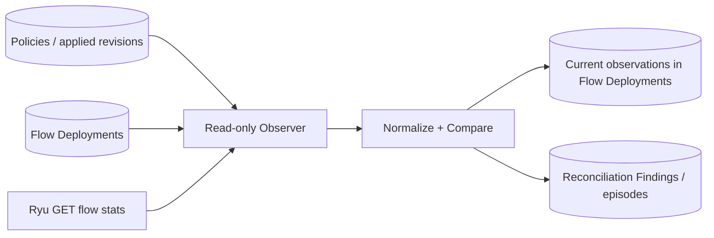

# LLNet v0.2 — Stage 4A: Read-Only Flow Observation

**Base:** `AhmadEmrani/IBN_SDN_with_SLM`, `main` tree `54d3a2709d9d130bbd69541a48e51b6c087d2dd3` (2026-11-07).

## Scope

This stage **does not reconcile by modifying the network**. `policy-reconciler` executes a read-only observer, and only `GET /stats/switches` plus `GET /stats/flow/{dpid}` are used. Evidence is written to the existing LLNet PostgreSQL database. Airflow has no part in the loop.

No changes to policy definitions/revisions, Airflow DAGs, Policy Operations, Scope Reservations, or OpenFlow rules.

## Flow of data

- **Expected:** applied revision's persisted `flow_deployments.flow_spec`, only for stable enabled policies (`desired_state=enabled`, `applied_state=installed`, active status, matching applied/desired revision IDs).
- **Actual:** Ryu flow stats, queried **once per relevant switch per cycle**, after a switch-connectivity check.
- **Identity:** known deployment cookie + normalized match (including IPv4 host vs `/32` and field aliases). Table ID, priority, and actions must also match exactly for `healthy`.
- **Ownership:** only previously registered cookies on stable policies may be considered for `extra`. A foreign cookie is ignored. Nothing is deleted.
- **Uncertainty:** malformed Ryu stats, disconnected switch, or failed HTTP request -> `unknown`, not `missing`.
- **In flight:** scope reservation or pending/queued/running/verifying/unresolved operation -> switch skipped. A second DB eligibility check prevents persisting a stale sample after concurrent policy changes.

## Persistent data (one migration)

**Existing** `flow_deployments`: updates `last_observed_at`, `observed_snapshot`, `deployment_status` for applied active deployments. These are *observations*, not a new desired policy revision. Before two valid observations a discrepancy is recorded in the snapshot with `confirmed=false`, and `deployment_status` retains the previous state.

**New** `reconciliation_findings`: one *episode* per open deviation, not one inserted event per poll. `kind` is `missing`, `modified`, `extra`, or `unknown`. Timestamps: `first_seen_at`, `last_seen_at`, `confirmed_at`, `resolved_at`; `consecutive_count` and bounded normalized `evidence` are retained for subsequent Stage 4B healing and evaluation.

`missing`, `modified`, and `extra` require two valid consecutive observations to be confirmed. A switch outage immediately creates `unknown`; it breaks confirmation streaks and never proves a prior drift resolved. Healthy observations resolve previous matching findings. When the applied revision is no longer expected, its old missing/modified findings are closed after a valid switch scan.

## Safety boundary

`app/reconciliation` imports and calls only `adapter.switches()` and `adapter.observed_flows()`. No Add/Delete OpenFlow endpoint, no Ryu POST, no repair operation, no dispatch or Airflow DAG. The shared `ryu_adapter` now rejects malformed flow-stats API envelopes instead of silently converting them into an empty flow list.

## Simplicity decisions

- Reuse existing database observation columns instead of duplicating snapshots in another table.
- One additional table for durable finding episodes; no event per healthy poll.
- One Docker service sharing the existing backend Dockerfile, CLI, ORM models, Ryu adapter, and main PostgreSQL.
- No new queue, task runner, API endpoints, alarm service, repair workflow, or extra Compose file.

## Testing and limitations

Local unit tests use a SQLite adapter and fake Ryu, and do not prove PostgreSQL lock/isolation behavior or actual Ryu/OVS state. End-to-end validation must include the real PostgreSQL migration, real REST reads, an enabled policy, and an optional controlled one-rule removal **after** baseline observation. Discovery of unrelated foreign-cookie flows is intentionally excluded; a registered cookie is a *candidate* identifier, not authorization to modify a flow.

Multi-process observers are not a supported deployment mode at this stage. Use exactly one `policy-reconciler` instance. The partial unique index on open finding keys protects against duplicate open episodes at the database level, but is not a distributed scheduling mechanism.
